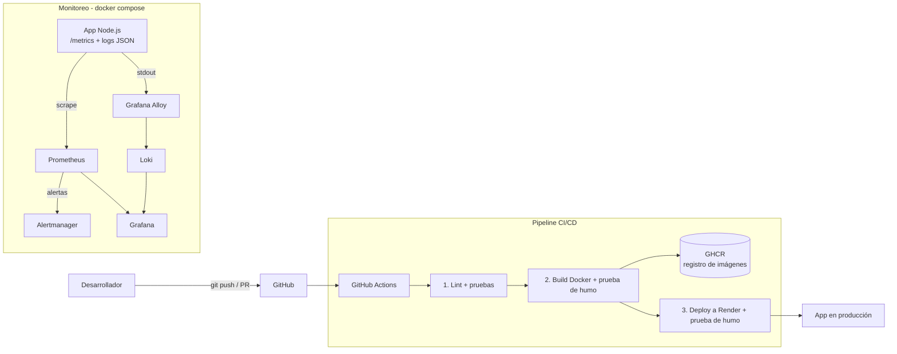

# Proyecto Final DevOps — Lista de Tareas


**Integrantes:** Nombre 1 · Nombre 2
**Asignatura:** Electiva 1 — Introducción a DevOps (ITLA)

Aplicación web de lista de tareas con un **pipeline DevOps completo**: control de versiones en GitHub, integración y despliegue continuo con GitHub Actions, contenedores Docker, pruebas automatizadas, análisis estático y monitoreo con métricas, logs centralizados y alertas.

## Arquitectura



| Componente | Tecnología |
|---|---|
| Frontend | HTML, CSS y JavaScript (`public/`) |
| Backend | Node.js 22 + Express (`src/`) |
| Base de datos | SQLite (módulo nativo `node:sqlite`) |
| Pruebas | Jest + Supertest (unitarias e integración), cobertura mínima 80 % |
| Análisis estático | ESLint |
| Contenedores | Dockerfile multi-stage + Docker Compose |
| CI/CD | GitHub Actions → GitHub Container Registry → Render |
| Monitoreo | Prometheus, Alertmanager, Grafana, Loki y Grafana Alloy |

## Inicio rápido

```bash
# Con Docker (app + monitoreo completo)
docker compose up -d --build
```

| Servicio | URL |
|---|---|
| Aplicación | http://localhost:3000 |
| Grafana (admin / admin) | http://localhost:3001 |
| Prometheus | http://localhost:9090 |
| Alertmanager | http://localhost:9093 |

Sin Docker:

```bash
npm install
npm test        # pruebas + cobertura
npm start       # http://localhost:3000
```

## API

| Método | Ruta | Descripción |
|---|---|---|
| GET | `/api/tareas` | Lista todas las tareas |
| GET | `/api/tareas/:id` | Obtiene una tarea |
| POST | `/api/tareas` | Crea una tarea (`{ "titulo": "..." }`, máx. 120 caracteres) |
| PATCH | `/api/tareas/:id` | Marca o desmarca la tarea como completada |
| DELETE | `/api/tareas/:id` | Elimina una tarea |
| GET | `/health` | Estado de la app, versión desplegada y base de datos |
| GET | `/metrics` | Métricas en formato Prometheus |

## Estructura del proyecto

```
├── src/
│   ├── app.js                 # Rutas Express y middleware de observabilidad
│   ├── server.js              # Arranque y apagado ordenado
│   ├── config.js              # Configuración por variables de entorno
│   ├── db.js                  # Conexión y esquema SQLite
│   ├── logger.js              # Logs estructurados en JSON
│   ├── metrics.js             # Métricas Prometheus
│   ├── repositories/          # Acceso a datos (SQL)
│   └── services/              # Reglas de negocio (validaciones)
├── public/                    # Frontend
├── tests/unit/                # Pruebas unitarias
├── tests/integration/         # Pruebas de integración (API + SQLite)
├── scripts/smoke-test.sh      # Prueba de humo post-despliegue
├── monitoring/                # Prometheus, Alertmanager, Alloy y Grafana
├── .github/workflows/ci.yml   # Pipeline CI/CD
├── Dockerfile
└── docker-compose.yml
```

## Documentación

- [Guía de instalación](docs/INSTALACION.md)
- [Documentación del pipeline](docs/PIPELINE.md)
- [Manual de operaciones](docs/OPERACIONES.md)
- [Guía de presentación, lecciones aprendidas y desafíos](docs/PRESENTACION.md)

## Flujo de trabajo con Git

1. Crear una rama desde `main`: `git checkout -b feature/nombre`.
2. Hacer commits pequeños con mensajes claros (`feat:`, `fix:`, `test:`, `docs:`, `ci:`).
3. Abrir un Pull Request: el pipeline corre lint, pruebas y la prueba del contenedor.
4. Hacer merge solo con el pipeline en verde (la rama `main` está protegida).
5. El merge a `main` publica la imagen y despliega a producción automáticamente.
