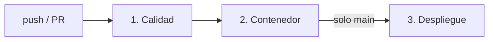

# Documentación del pipeline CI/CD

Archivo: [`.github/workflows/ci.yml`](../.github/workflows/ci.yml)

## Cuándo se ejecuta

| Evento | Qué corre |
|---|---|
| Pull Request hacia `main` | Job 1 (calidad) y Job 2 (contenedor, sin publicar) |
| Push / merge a `main` | Jobs 1, 2 y 3: publica la imagen y despliega a producción |
| Manual (`workflow_dispatch`) | Botón *Run workflow* en la pestaña Actions |

Si llegan dos pushes seguidos a la misma rama, la ejecución anterior se cancela (`concurrency`).

## Etapas



### Job 1 — Calidad (lint + pruebas)

| Paso | Comando | Falla si… |
|---|---|---|
| Instalar dependencias | `npm ci` (o `npm install` si no hay lockfile) | una dependencia no se puede instalar |
| Análisis estático | `npm run lint` (ESLint) | hay errores de código (variables sin usar, `==`, etc.) |
| Pruebas unitarias | `npm run test:unit` | falla una prueba de `tests/unit` |
| Pruebas de integración | `npm run test:integration` | falla una prueba de `tests/integration` |
| Cobertura | `npm run test:ci` | la cobertura baja de 80 % de líneas / 70 % de ramas |

El resumen de cobertura aparece en la página de la ejecución (*Summary*).

### Job 2 — Imagen Docker + prueba de humo

1. Construye la imagen con el SHA del commit como versión (`APP_VERSION`).
2. Levanta el contenedor y ejecuta [`scripts/smoke-test.sh`](../scripts/smoke-test.sh): verifica `/health` (con la versión correcta), crea, lista y elimina una tarea, y revisa `/metrics` y el frontend.
3. Si todo pasa y es un push a `main`, publica la imagen en **GitHub Container Registry**:
   - `ghcr.io/michaelp16/node-cicd-pipeline:<sha>` (inmutable, para rollback)
   - `ghcr.io/michaelp16/node-cicd-pipeline:latest`

La imagen aparece en la sección *Packages* del repositorio.

### Job 3 — Despliegue a producción (Render)

1. Llama al *deploy hook* de Render (secreto `RENDER_DEPLOY_HOOK_URL`).
2. Ejecuta la prueba de humo contra la URL pública y **espera hasta que `/health` muestre el SHA del commit nuevo** (máximo 15 minutos). Así se confirma que la versión nueva está en producción.

Si los secretos de Render no están configurados, el job muestra una advertencia y se omite sin poner el pipeline en rojo.

## Configuración inicial

### 1. Proteger la rama `main`

*Settings → Branches → Add branch ruleset* (o *Add rule*):
- Branch name pattern: `main`
- ✅ Require a pull request before merging
- ✅ Require status checks to pass → seleccionar **1. Calidad (lint + pruebas)** y **2. Imagen Docker + prueba de humo**

### 2. Crear el servicio en Render (plan gratuito)

1. Entrar a https://render.com con la cuenta de GitHub.
2. *New → Web Service* → conectar el repositorio `node-cicd-pipeline`.
3. Configurar:
   - **Language / Runtime:** Docker
   - **Branch:** `main`
   - **Instance type:** Free
   - **Health Check Path** (en *Advanced*): `/health`
   - **Auto-Deploy:** *Off* (el pipeline decide cuándo desplegar, solo si las pruebas pasan)
4. Crear el servicio y copiar su URL (por ejemplo `https://tareas-devops.onrender.com`).
5. En *Settings → Deploy Hook*, copiar la URL del hook.

### 3. Guardar los datos en GitHub

*Settings → Secrets and variables → Actions*:

| Tipo | Nombre | Valor |
|---|---|---|
| **Secret** | `RENDER_DEPLOY_HOOK_URL` | URL del deploy hook de Render |
| **Variable** | `RENDER_APP_URL` | URL pública de la app en Render |

El deploy hook es un secreto: cualquiera que lo tenga puede disparar despliegues. Nunca se escribe en el código.

### 4. (Opcional) Aprobación manual antes de producción

*Settings → Environments → produccion → Required reviewers*: agregar al compañero. Así el Job 3 espera que alguien apruebe antes de desplegar.

### 5. Desactivar GitHub Pages

La plantilla original desplegaba a GitHub Pages, que solo sirve archivos estáticos (la API no funcionaba ahí). Ahora el despliegue es a Render, así que se puede desactivar en *Settings → Pages*.

## Rollback (volver a una versión anterior)

**Opción 1 — revertir el commit (recomendada):**

```bash
git revert <sha-del-commit-malo>
git push origin main      # el pipeline prueba y despliega la versión corregida
```

**Opción 2 — desde Render:** *Events* → elegir un despliegue anterior → *Rollback*.

**Opción 3 — imagen anterior en local:**

```bash
docker run -d -p 3000:3000 ghcr.io/michaelp16/node-cicd-pipeline:<sha-anterior>
```

## Demostrar que el pipeline bloquea errores

1. Crear una rama: `git checkout -b demo/prueba-rota`.
2. Romper una prueba, por ejemplo en `tests/unit/validacion.test.js` cambiar `toBe(7)` por `toBe(8)`.
3. Hacer push y abrir un PR: el Job 1 queda en **rojo** y GitHub bloquea el merge.
4. Corregir la prueba, hacer push: el pipeline pasa a **verde** y se habilita el merge.
